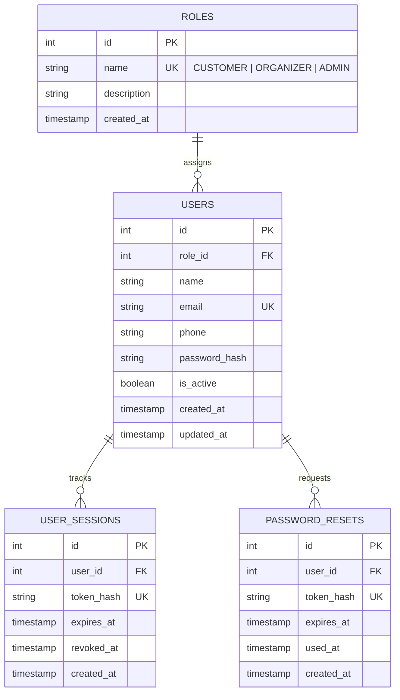

# Event Planning and Management System (SYP)
## Authentication & Authorization (RBAC) Module

An online marketplace where customers can browse, plan, and book events (birthdays, weddings, anniversaries, and small celebrations) while event organizers coordinate activities (catering, decor, makeup, entertainment) and administrators manage the entire platform.

---

## 🏗️ Architecture & Features

### 1. User Registration & Role Enforcement
- **Public Registration (`POST /api/auth/register`)**: Open to customers. Role injection guards ensure that any external attempts to supply `role: 'ADMIN'` or `role: 'ORGANIZER'` are rejected or safely enforced as `CUSTOMER`.
- **Restricted Staff Creation (`POST /api/admin/users`)**: Restricted endpoint accessible strictly by `ADMIN` to provision `ORGANIZER` / Staff and administrative accounts.
- **Input Validation**: Sanitizes emails, enforces phone format, and checks password strength (min 8 characters, uppercase, lowercase, number, special character).

### 2. Login, Token Issuance & Logout Invalidation
- **Authentication**: Stateless JSON Web Tokens (JWT) signed with HMAC SHA-256 and RFC 7519 unique `jti` identifiers.
- **Dual Delivery**: Delivered via JSON response and secure HTTP-only cookies.
- **True Session Invalidation (`POST /api/auth/logout`)**: Common JWT tutorials suffer from the flaw that tokens remain valid after logout until expiration. This implementation stores SHA-256 session digests in the `user_sessions` table and marks them revoked upon logout, returning `401 Unauthorized` on any subsequent reuse.

### 3. Password Management & Security
- **Bcrypt Hashing**: Passwords stored using `bcryptjs` with 10 salt rounds.
- **Forgot Password (`POST /api/auth/forgot-password`)**: Generates cryptographically secure 32-byte hex tokens, hashes them via SHA-256 for database storage with 1-hour expiration.
- **Reset Password (`POST /api/auth/reset-password`)**: Validates token, hashes new password, marks token as used (replay attack prevention), and revokes all active user sessions for security.
- **Password Update (`PUT /api/auth/update-password`)**: Authenticated users can change passwords after validating their current password.

### 4. Role-Based Access Control (RBAC)
- **Role Hierarchy**:
  - `CUSTOMER`: Accesses customer dashboard, event packages, and booking submissions.
  - `ORGANIZER`: Accesses coordination hub, customer requests, and vendor assignments (catering, decoration, entertainment).
  - `ADMIN`: Full access to user management, system metrics, and audit logs.
- **Guarded Middleware**:
  - `authenticate`: Validates JWT signature, checks DB revocation, verifies user is active (`is_active = 1`).
  - `authorize(...roles)`: Rejects unauthorized roles with `403 Forbidden`.

---

## 🗄️ Database Schema

The database runs out of the box using SQLite via Node.js native engine, and is 100% ANSI SQL compatible with PostgreSQL and MySQL.



---

## 🚀 Quick Start Guide

### 1. Install Dependencies
```bash
npm install
```

### 2. Run the Server
```bash
# Start standard server
npm start

# Or start in watch mode for development
npm run dev
```
The server will boot on `http://localhost:5000` and automatically initialize the database schema and seed default accounts.

### 3. Run Automated Tests
```bash
npm test
```
Executes the comprehensive 34-point integration test suite testing all endpoints, guards, and edge cases.

---

## 🔑 Pre-Seeded Default Accounts

| Role | Email | Password | Allowed Dashboards |
| :--- | :--- | :--- | :--- |
| **Admin** | `admin@eventhub.com` | `Admin@12345` | `/api/admin/*`, `/api/organizer/*` |
| **Organizer / Staff** | `organizer@eventhub.com` | `Organizer@12345` | `/api/organizer/*` |
| **Customer** | `customer@eventhub.com` | `Customer@12345` | `/api/customer/*` |

---

## 📡 API Route Reference

### 🔐 Authentication (`/api/auth`)
| Method | Endpoint | Access | Description |
| :--- | :--- | :--- | :--- |
| `POST` | `/api/auth/register` | Public | Register customer account |
| `POST` | `/api/auth/login` | Public | Login and receive JWT & cookie |
| `POST` | `/api/auth/logout` | Authenticated | Invalidate session & clear cookie |
| `GET` | `/api/auth/me` | Authenticated | Get current user profile |
| `POST` | `/api/auth/forgot-password` | Public | Request password reset token |
| `POST` | `/api/auth/reset-password` | Public | Reset password using token |
| `PUT` | `/api/auth/update-password` | Authenticated | Change current password |

### 👤 Customer Features (`/api/customer`)
| Method | Endpoint | Required Role | Description |
| :--- | :--- | :--- | :--- |
| `GET` | `/api/customer/dashboard` | `CUSTOMER` | Customer summary & bookings |
| `GET` | `/api/customer/packages` | `CUSTOMER` | Browse event packages |
| `POST` | `/api/customer/bookings` | `CUSTOMER` | Submit new event booking |

### 📋 Organizer & Staff (`/api/organizer`)
| Method | Endpoint | Required Role | Description |
| :--- | :--- | :--- | :--- |
| `GET` | `/api/organizer/dashboard` | `ORGANIZER`, `ADMIN` | Staff coordination metrics |
| `GET` | `/api/organizer/requests` | `ORGANIZER`, `ADMIN` | Customer event coordination list |
| `PATCH` | `/api/organizer/requests/:id/assign` | `ORGANIZER`, `ADMIN` | Assign vendor/activity |

### ⚙️ Administrator (`/api/admin`)
| Method | Endpoint | Required Role | Description |
| :--- | :--- | :--- | :--- |
| `GET` | `/api/admin/dashboard` | `ADMIN` | System privileges summary |
| `GET` | `/api/admin/users` | `ADMIN` | List all platform users |
| `POST` | `/api/admin/users` | `ADMIN` | Create Staff, Organizer or Admin |
| `PATCH` | `/api/admin/users/:id/status` | `ADMIN` | Activate/Deactivate user |
| `GET` | `/api/admin/reports` | `ADMIN` | Platform metrics & sessions |

---

## 💻 Interactive Web Application

The frontend is served directly by Express at `http://localhost:5000/`.

- **Marketplace View**: Browse packages, filter by category (Weddings, Birthdays, Anniversaries), and initiate bookings.
- **Interactive Modals**:
  - Login modal with **One-Click Demo Login Pills** (Admin, Organizer, Customer).
  - Customer Registration modal with a live password-strength meter.
  - Forgot/Reset Password flow with on-screen token preview for testing.
- **Role-Based Views (SPA)**:
  - **Customer Portal**: View booking history and submit new event requests.
  - **Organizer Workspace**: Review customer requests and assign vendors (Catering, Decoration, Makeup, Sound).
  - **Admin Control Panel**: View user breakdowns, provision new staff accounts, and toggle user active/suspended status in real-time.
